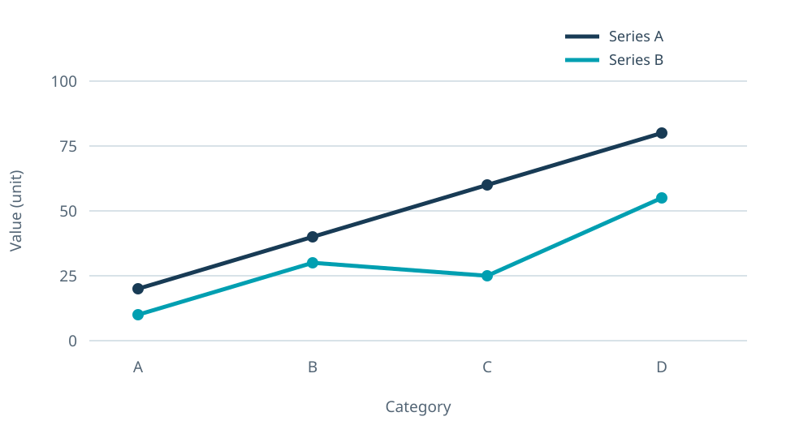
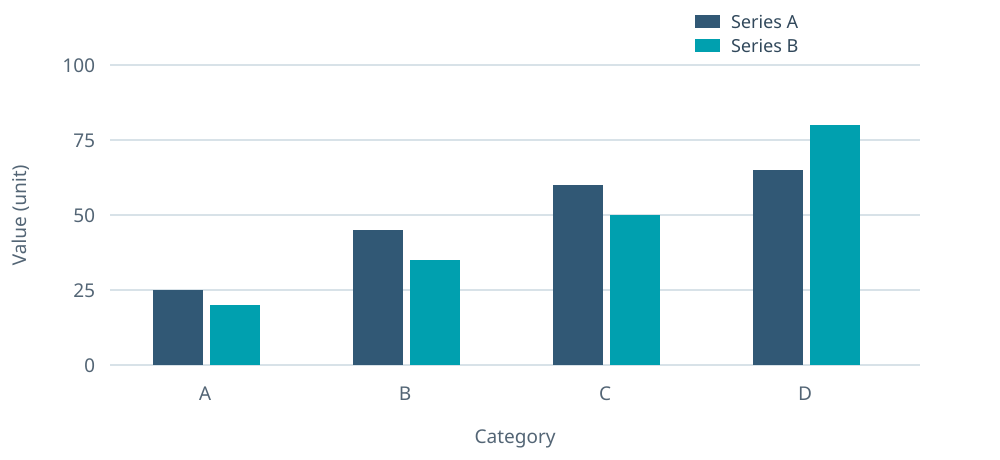
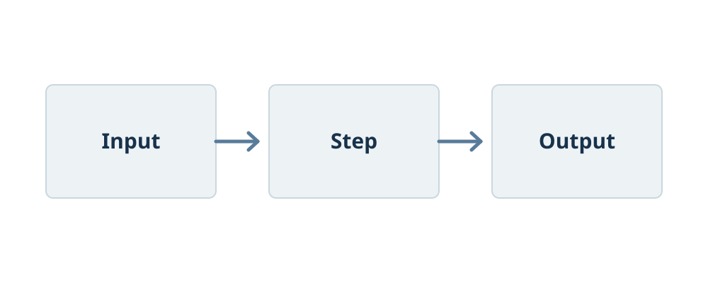

# 1 — Typography and spacing

This page shows the main type hierarchy, paragraph spacing, and restrained use of color. Lorem ipsum dolor sit amet, consectetur adipiscing elit. Integer posuere, nisl at facilisis suscipit, neque massa luctus lectus, vitae varius ante neque at lorem.

## A section heading

Vivamus at augue vitae ipsum posuere feugiat. Mauris vitae velit in lacus luctus fermentum. Suspendisse potenti.

> Note: a short callout can make one qualification easier to find.

# 2 — Tables {: .page-start }

Tables keep values selectable and use light rules to guide the eye.

### Table 1: Compact example

| Category | Value | Note |
|---|---:|---|
| Alpha | 12 | Example entry |
| Beta | 18 | Example entry |
| Gamma | 24 | Example entry |

### Table 2: Dense example

| Group | A | B | C | D | Total | Note |
|---|---:|---:|---:|---:|---:|---|
| One | 12 | 15 | 11 | 14 | 52 | Example |
| Two | 18 | 17 | 19 | 16 | 70 | Example |
| Three | 21 | 20 | 22 | 23 | 86 | Example |
| Four | 14 | 13 | 16 | 15 | 58 | Example |

# 3 — Image {: .page-start }

Use this treatment for a photograph, screenshot, or illustrative image. The caption precedes the visual and stays with it.

### Figure 1: Abstract image example


# 4 — Chart {: .page-start }

Line charts show change across an ordered sequence. Bar charts compare discrete categories. Labels and legends remain readable in print.

### Figure 2: Generic line chart



### Figure 3: Generic bar chart



# 5 — Diagram {: .page-start }

A diagram should communicate direction or relationships with few marks and consistent spacing.

### Figure 4: Three-step diagram



# 6 — Code and notes {: .page-start }

Aligned text uses a monospace face. Keep source lines complete when the block serves as evidence.

### Figure 5: Aligned text example

```text
Label   : Alpha
Value   : 12
Status  : Example
```

Inline `code` can appear inside a normal paragraph without changing its type scale.
